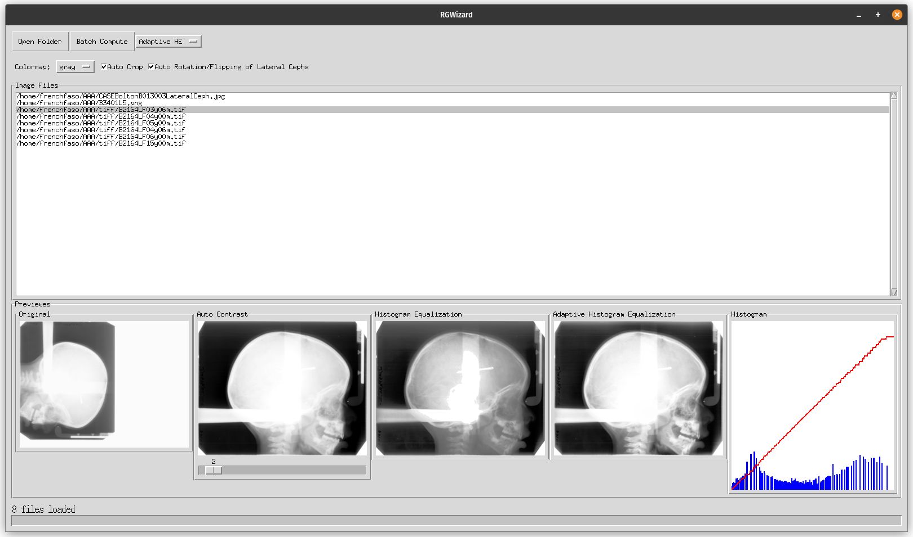

# RGWizard
RGWizard is a cross-platform graphical user interface (GUI) application developed for the viewing and analysis of radiographic images, specifically tailored for the radiographs from the Bolton Brush Legacy Growth Study Collection. This collection predominantly features radiographs collected during the 1930s, though it extends until the 1980s.  
The name RGWizard draws inspiration from the DICOM Modality (a key attribute of the DICOM standard), with "RG" representing Radiographic imaging (conventional film/screen), highlighting the application's focus on facilitating academic and research-oriented examination of radiographic scanned imagery, which could be decayed or otherwise in a poorer quality state compared to digitally acquired radiographs.  
By employing various computational enhancement techniques, RGWizard serves as a specialized tool for researchers and academics working with this historically significant collection.



## Overview

RGWizard integrates a suite of image processing algorithms to support radiographic research and analysis, particularly focusing on the unique needs and challenges associated with the Bolton Brush Legacy Growth Study Collection. It allows for the direct comparison between original and computationally enhanced radiographs images, aiding in the interpretation and study of radiographic data from this collection.

## Features

- **Original radiograph Image Viewing**: Enables the examination of radiograph images in their unaltered state, providing a baseline for comparison with enhanced outcomes.

- **Image Enhancement Techniques**:
  - **Auto Contrast Adjustment**: Implements automatic contrast adjustment to improve the visibility of radiograph image features.
  - **Histogram Equalization**: Applies histogram equalization to redistribute the image's intensity, enhancing overall detail.
  - **Adaptive Histogram Equalization (CLAHE)**: Employs CLAHE for localized contrast enhancement, particularly beneficial for highlighting subtle nuances in radiograph images.

- **Real-time Histogram Feedback**: Incorporates a histogram display that offers immediate feedback on the intensity distribution changes resulting from the applied image enhancements, facilitating a deeper understanding of these processes.

- **Automated Image Preprocessing**:
  - **Auto Crop**: Automatically identifies and removes extraneous white borders, focusing on the pertinent radiographic content.
  - **Auto Rotation and Flipping via AI**: The bundled FastAI model detects frontal and lateral cephalometric radiographs and corrects their orientation through rotation and/or flipping. Its output vocabulary covers the `frontal_<angle>[F]` and `lateral_<angle>[F]` classes for 0, 90, 180, and 270 degrees, plus `none` for images that should not be changed.

- **Batch Enhancement Application**: Allows for the chosen enhancement technique, including automatic enhancements like auto crop and neural network model enhancements, to be applied in batch to all loaded radiographs. This feature streamlines the process of applying consistent enhancements across a collection of images, ensuring uniformity and saving significant time for researchers.

## Usage
### Installation
RGWizard can be packaged as a standalone executable, streamlining deployment and use without the need for a traditional installation process.  
Prebuilt bundles, when available for a release, are published in the project's [Releases section on GitHub](https://github.com/open-ortho/RGW/releases). The current source tree can also be built locally with PyInstaller, as described below.

Windows users might require Microsoft Visual C++ redistributable package to ensure RGWizard runs properly. It can be downloaded from [Microsoft's official site](https://visualstudio.microsoft.com/downloads/#microsoft-visual-c-redistributable-for-visual-studio-2022).


### Building from Source
To compile RGWizard from the source code, one should first obtain the repository's contents. This can be achieved by cloning the repository or downloading the ZIP file containing the source code.  
Following this, create a Python 3.12 environment. The current dependency set has been validated with Python 3.12, PyTorch 2.13, FastAI 2.8.7, and timm 1.0.28.

#### Using Conda
To create a Python environment with Conda, execute the following command in your terminal:
```bash
conda create -n rgw python=3.12 pip
conda activate rgw
```
This creates a new Conda environment named rgw and activates it.

#### Using Venv
For creating a Python environment with venv, the commands are as follows:
```bash
python3.12 -m venv RGWizard-env
source RGWizard-env/bin/activate  # On Windows, use `RGWizard-env\Scripts\activate`
```
This sequence creates and activates a new virtual environment named RGWizard-env.

#### Installing Dependencies
Once the environment is set up, install the required dependencies with:
```bash
python -m pip install -r requirements.txt
```

The model was exported with the compiled build of `plum-dispatch`. PyPI provides compiled wheels for the Linux and Windows targets used by RGWizard, but not for macOS on Apple Silicon. On an Apple Silicon Mac, compile the same Plum 2.9.0 build after installing the requirements:

```bash
CC=/usr/bin/clang CXX=/usr/bin/clang++ HATCH_BUILD_HOOKS_ENABLE=1 \
  python -m pip install --force-reinstall --no-deps \
  --no-binary=plum-dispatch plum-dispatch==2.9.0
```

#### Building the Executable
Finalize the build process by generating a deployable bundle for your platform with PyInstaller. If the `models` folder is present, it is bundled into the executable by `RGWizard.spec`; otherwise the app builds without AI auto-rotation/flipping.
```bash
pyinstaller --clean --noconfirm RGWizard.spec
```
This command compiles the application. After this step, you should find the generated bundle under the `dist` folder, ready for deployment. On macOS, PyInstaller also creates an app bundle. The `build` and `dist` folders are generated artifacts and can be removed and regenerated.
